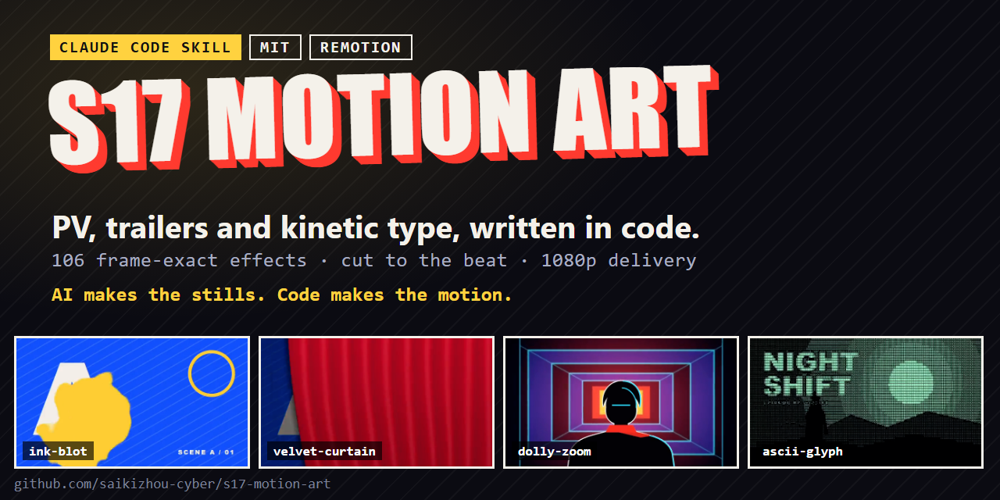
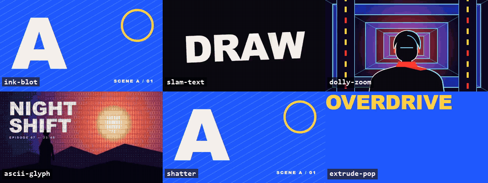
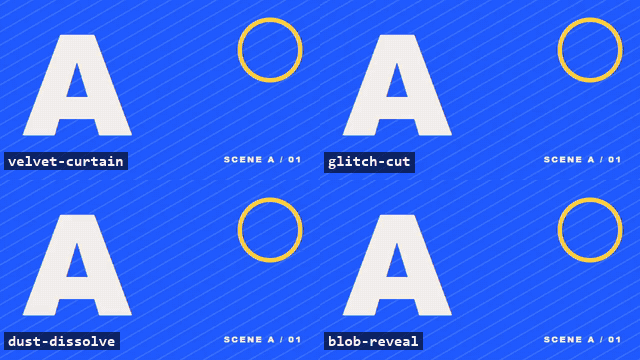
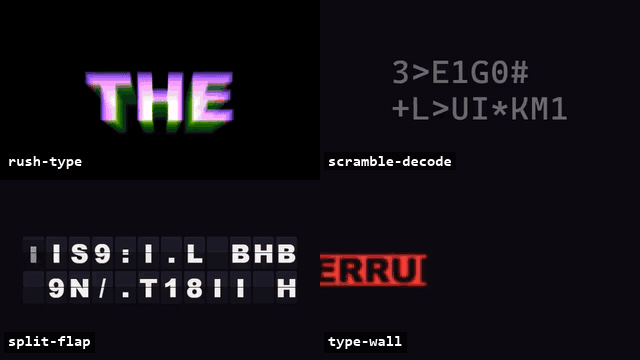
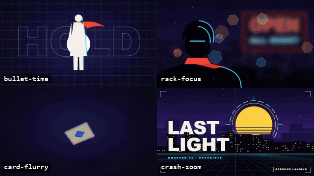
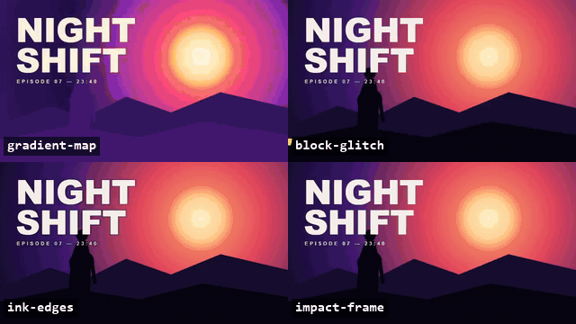
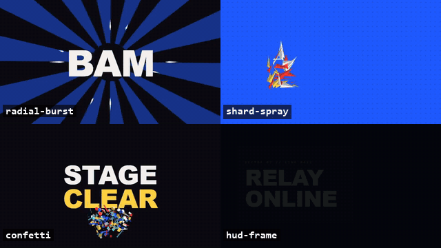
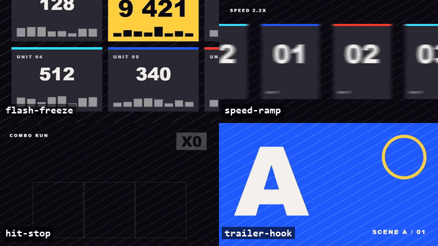
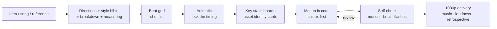

<div align="center">



# S17 Motion Art

**Write PVs, trailers and kinetic type as code: frame-exact, cut to the beat, editable. A Claude Code skill with 106 ready-made effects.**

[](LICENSE)
[](https://code.claude.com/docs/en/skills)
[](https://saikizhou-cyber.github.io/s17-motion-art/)
[](https://www.remotion.dev/)
[](#-what-was-measured)

[**Live gallery**](https://saikizhou-cyber.github.io/s17-motion-art/) · [Install](#-install-in-one-line) · [Usage](#-what-to-say) · [The effects](#-106-ready-made-effects) · English · [中文](README.md)



<sub>Real renders of the library's own demos. [See 66 of them move in the gallery.](https://saikizhou-cyber.github.io/s17-motion-art/)</sub>

</div>

---

## Why this exists

Most AI video tools give you a clip you cannot edit: change one word and you generate again. This skill works the other way round. **Motion is code** (React components driven by the frame number, rendered with [Remotion](https://www.remotion.dev/)), so every cut, ease and colour stays editable and a re-render gives the same film. AI is used only where code draws badly: still art such as characters, props and plates, and only when you have none of your own.

- **From an idea or a song to a film.** Three creative directions, a style bible, a beat-cut shot list, an animatic, then the film and a 1080p delivery with automatic QA.
- **Cut to the music.** It measures your track's tempo grid, plans every shot on it and checks the finished film for freezes, flashes and cuts that drifted off the beat.
- **A real effects library.** 106 transitions, kinetic-type, camera, post-FX, HUD and edit-timing effects you can drop into any Remotion project, each one a pure function of the frame.
- **Rebuild a reference's structure and timing 1:1, with your own art.** Measure a reference video's cuts, colours and motion (easing and spring fits, perspective depth) and rebuild its structure with your own characters, copy and art; nothing from the reference is copied.

### Which part do you need?

| You want | Start with | You need |
|---|---|---|
| **Effects for your own Remotion project** | [`pick.py`](#-what-to-say) (no Claude needed) | a Remotion 4 project (tested 4.0.530); shader effects also need Chrome 149+, which Remotion downloads |
| **A whole PV or trailer, cut to music** | `/s17-motion-art` in Claude Code | Claude Code (a paid plan or API usage), Node.js 18+, ffmpeg, Python 3.10+ |

**How it differs:** AI video generators give you a clip you regenerate to change; After Effects presets and Lottie live on a GUI timeline; Remotion templates are whole-video starters. This is a library of small, copyable code effects plus an agent pipeline that plans the cuts on the music and checks the result.

**Not for:** one-click films (you approve the direction, the animatic and the key boards), vertical 9:16 pipelines (the effects scale, but the reference-comparison tools assume 16:9), or tight budgets (the 36-second case study used 13.4 M output tokens; a 12-second test trailer took about half an hour of agent time).

**Terms:** PV = promotional video (a game or anime trailer) · animatic = a rough cut of still boards timed to the music · kinetic type = animated text · beat grid = the frames on which the music's beats fall.

## 🚀 Install in one line

```bash
git clone --depth 1 https://github.com/saikizhou-cyber/s17-motion-art.git "$HOME/.claude/skills/s17-motion-art"
```

About 35 MB; works in bash and PowerShell. For one project only, clone into `.claude/skills/s17-motion-art` inside it. Then type `/s17-motion-art`, or just say "make me a PV" or "rebuild this video 1:1"; the skill loads automatically. Other coding agents that read the Agent Skills format (`SKILL.md`): put the folder in their skills directory (not individually tested).

**Requirements**: [Claude Code](https://code.claude.com/) (a paid plan or API usage), Node.js 18+, [ffmpeg](https://ffmpeg.org/) (with ffprobe), Python 3.10+ (`python -m pip install pillow numpy scipy`; `python3` on macOS/Linux, `py -3` where `python` is not Python 3). Shader effects and transitions render in Chrome 149+ with a GL backend, which Remotion 4.0.5xx downloads (`swangle` without a GPU). Tested on Windows 11 + Git Bash. Optional: [rembg](https://github.com/danielgatis/rembg) for cutouts, the Jimeng (即梦) canvas CLI or any image generator (stills only). Commands in the docs are written for a POSIX shell; on Windows use Git Bash. The tools assume **16:9, 30 fps, a 1280×720 composition named `PV`**; conform other references first: `ffmpeg -i in.mp4 -vf fps=30,scale=1280:720 -an reference.mp4`.

## 💬 What to say

Try it with nothing prepared (the fast lane for short films: no questions, code-drawn art, 0 credits):

```text
/s17-motion-art Make a 12-second kinetic-type trailer for a game called ECHO. Code only, no music, don't ask me questions.
```

With your own material:

```text
/s17-motion-art Make a 30-second PV: an MC battle on a late-night radio show, starring my original
character (sheet in ./oc.md), music ./track.wav. Give me three creative directions first, then a shot list
and an animatic for the one I pick.
```

```text
/s17-motion-art Rebuild the shot structure and rhythm of ./reference.mp4 1:1, with the characters
from ./cards/ and a logo of our own.
```

Or use only the library, in any Remotion project (no Claude needed). Run it from the project folder (Git Bash on Windows):

```bash
npx create-video@latest        # only if you have no Remotion project yet
python ~/.claude/skills/s17-motion-art/library/gallery/pick.py slam-text --to src/s17
```

It copies just that effect (plus the helpers it imports) and prints the npm packages it needs. Then put `<SlamText text="DRAW" />` inside a `<Sequence>` of your composition and run `npx remotion studio`. Each effect file ends with a `Demo` that shows real usage; the props are listed in [`library/catalog/`](library/catalog/).

It is **not** one-click: you approve the direction, the animatic and the key static boards; the final quality depends on your standards and the number of review rounds.

## ✨ Four modes

| Mode | You give it | It makes |
|---|---|---|
| **create** | a line, a world or a song | three contrasting creative directions → style bible → beat-cut shot list → animatic → film |
| **realize** | your characters, props and scenes | an identity card per asset (including a three-panel character sheet prompt); every generated still is checked against it so nothing drifts |
| **rebuild** | a reference video | cuts, colours and motion measured, then structure and rhythm rebuilt 1:1 with original content |
| **deliver** | the finished project | chunked 1080p render, music swap without re-rendering, loudness, automatic QA, retrospective |

**The core is "measure it, write it as code":**
- `motion_fit.py` turns the motion of an element in a reference into Remotion `interpolate` easing or `spring` parameters you can paste; perspective fly-ins are fitted in depth, and moves held on twos are detected.
- `beat_check.py` measures a track's tempo grid and checks whether the cuts land on its accents.
- `film_scan.py` finds freezes, black and flash frames the reference doesn't have, and shots that are stiller or busier than the reference.

## 🧩 106 ready-made effects

All code, frame-deterministic, written in 720p units so they work at any resolution. Not limited to Remotion's own packages: three.js, GSAP, anime.js, Lottie, WebGL and canvas all work as long as the frame number drives them. **[Browse all 106 in the live gallery (66 as clips) →](https://saikizhou-cyber.github.io/s17-motion-art/)**

<table>
<tr>
<td width="50%" align="center"><br><b>Transitions (23)</b><br><sub>impact cut, glitch tear, ink blot, velvet curtain, shatter, halftone wipe, CRT power-off, VS slam…</sub></td>
<td width="50%" align="center"><br><b>Kinetic type (21)</b><br><sub>slam, char cascade, scramble decode, split-flap, number roll, RGB rush, type wall, text turning to dust…</sub></td>
</tr>
<tr>
<td align="center"><br><b>Camera (13)</b><br><sub>shake, crash zoom, handheld, dolly zoom, parallax stack, rack focus, bullet time, Kanada snap…</sub></td>
<td align="center"><br><b>Post FX and hits (22)</b><br><sub>RGB split, glitch, VHS, CRT, film grain, halftone, gradient map, ink edges, shockwave, ASCII filter…</sub></td>
</tr>
<tr>
<td align="center"><br><b>Shapes and HUD (18)</b><br><sub>speed lines, radial burst, shard spray, confetti, HUD frame, reticle lock, telemetry readout, SVG morph…</sub></td>
<td align="center"><br><b>Edit timing (9)</b><br><sub>trailer hook, beat accelerando, blackout slam, flash freeze, speed ramp, hit stop, on-twos shift…</sub></td>
</tr>
</table>

Copy only what you use with `python library/gallery/pick.py <id>,<id> --to src/s17`, then set the props. The index of all effects and how to copy them are in [`library/README.md`](library/README.md); each category has a table (what you see, when to use it, props) in `library/catalog/`, and six effects carry a "watch out" note that was checked by rendering, such as which frame is the hit.

Sources: code ported from MIT / Apache-2.0 projects (54 files keep their original copyright header; licence texts in [`THIRD_PARTY_NOTICES.md`](THIRD_PARTY_NOTICES.md) and `LICENSES/`), the rest original or reimplemented from an idea.

## 📏 What was measured

- **Deterministic renders:** each demo's middle frame rendered twice, with another frame in between: 89 effects pixel-identical, 17 within 2 levels of anti-aliasing rounding ([report](library/previews/determinism.txt); reproduce with `npm run previews` in `library/`). `npm run lint` is a static check of `effects/` that rejects `Math.random`, `Date`, timers and CSS animations; randomness comes from seeds.
- **A/B against no skill:** two versions of the skill were each judged blind against the same film made without it (one 12-second brief, model judges who saw the films and their files). All four verdicts, two viewing orders each, picked the skill's film, one of them on a tied overall score. The no-skill run hit Remotion's audio mux running about 43 ms late and had to write its own onset check to find it (with the skill that is `audio_offset.py`), and it shipped full-range `yuvj420p` video with only a `bt470bg` matrix tag. Caveat: one brief, one no-skill film, model judges; the films are not published.
- **A real project:** a 36-second game-collaboration PV (57 shots, 8 acts) delivered in 1080p; the ledger is below.

| | Measured on that project |
|---|---|
| Wall clock / active | 66.7 h / 18.8 h (active includes time the agents worked alone) |
| User messages | 113 (44 with screenshots) |
| Model turns / output tokens | 11,467 / 13.4 M (main loop 778 Opus / 324 Sonnet turns; sub-agents moved to Sonnet after the user asked; Opus wrote 82.5 % of the output) |
| AI generation (mostly stills) | 121 images + 9 clips = 1,184 Jimeng credits (estimated from generation counts × price) |
| Wasted | 5 of 9 AI clips unused → so motion is code by default and an AI clip is a last resort for a pose already approved as a still |

Full write-up: [`references/case-study-gamepv.md`](references/case-study-gamepv.md).

<div align="center">

<br><sub>Clips from that PV, showing rebuild mode: the shot structure, rhythm and the effect compositions in the second half (wedge type, shards, white finale) were rebuilt 1:1 from a commercial PV as a study; characters, names and copy are original, the character art is AI-generated, and all motion is code.</sub>
<br>
</div>

## 🧭 Workflow



Seven rules (details in [`SKILL.md`](SKILL.md)):

1. Motion is code, and deterministic; AI makes still assets only.
2. Original content only: never generate, cut out, trace or imitate a franchise character, logo, wordmark or title lockup, UI skin, signature prop, custom lettering, lyric or music.
3. Still before motion: approve the direction, animatic and key static boards before animating; build the climax first.
4. Measure, don't eyeball: frames, moves, music and the render each have a measuring tool; one set of placement numbers per figure across consecutive shots.
5. Builders don't judge their own work: sub-agents build on a mid-tier model; critics see only the render, compare two versions in both orders, and every accepted fix comes with before/after frames.
6. Budget before spending.
7. Nothing is "done" until it is verified.

## 🧰 Toolbox (`scripts/`)

| Job | Scripts |
|---|---|
| Measure | `frame_measure.py` (frame grab, colours, blobs, bbox, IoU) · `motion_fit.py` (a move → Remotion easing/spring code) · `cut_detect.py` (cuts + numbered review sheets) |
| Compare with a reference | `compare.py` · `shotsheet.py` · `grid.py` · `strip.py` · `side-by-side.mjs` (local only) · `contact_sheet.py` (a film without a reference) |
| Music and timing | `beat_check.py` (tempo grid; cuts vs accents) · `audio_offset.py` (A/V sync) · `animatic.py` (boards + music → rough cut) |
| Still assets | `cutout.py` · `cleanedge.py` · `bluekey.py` · `hairfix.py` · `irisglow.py` (examples for one character: edit their colour constants) · `jm.py` · `jimeng_batch_run.py` · `jimeng_video_run.py` |
| Render and QA | `render-chunks.mjs` (chunks, join, music swap, loudness) · `film_scan.py` (freezes, black, flashes, per-shot motion vs reference) |
| Retrospective | `transcript_stats.py` (time, messages, per-model tokens) |

Every command is in [`references/pipeline-recipes.md`](references/pipeline-recipes.md).

## 🧠 Lessons that cost the most

- **"Looks similar" is not 1:1**; early shots kept being rejected. → moves are now measured with `motion_fit.py` instead of tuning easing by eye.
- **The same character changed size across three consecutive shots**; four rounds of fixes. → one shared constant.
- **AI clips with the wrong pose or a cropped figure**: 5 of 9 wasted. → motion moved to code; AI makes stills only.
- **A 14-agent parallel build hit the usage limit and returned nothing.** → batches that persist to disk.
- **The full render froze at frame 725.** → chunks; segments are silent, so new music is a 5-second remux.
- **A shot silently froze for almost a second and nobody noticed in per-shot review.** → `film_scan.py` finds it.
- **Our own brand lockup borrowed the original logo's construction.** → before publishing, check every lockup, badge and effect shape for lookalikes.

## ❓ FAQ

**Do I need to code?** The AI writes the code. You need to install Node and ffmpeg and give feedback on comparison boards and the animatic.

**Do I need Jimeng?** No. AI is only used for still assets and any image generator works; if you have your own art, no AI is needed at all.

**Can I rebuild a video with copyrighted characters?** You can study its shot structure and rhythm for learning or private research; characters, logos/wordmarks, UI styles, lyrics, music and traced graphics must all be original. Renaming is not a way around infringement; assess the risk yourself before publishing. The skill refuses to generate, cut out, trace or imitate protected content.

**How long and how much?** See the ledger. Pure code-motion shots cost no credits; shots with character art cost per still. Claude usage comes on top: that project used 13.4 M output tokens and hit the usage limit 5 times, so start with a few shots.

**Is Remotion free?** Free (commercial use included) for individuals, for-profit companies with up to 3 employees and non-profits; larger companies need a company license. See the [Remotion license](https://www.remotion.dev/license).

## 📁 Layout

```text
s17-motion-art/
├── SKILL.md                      # entry point: four modes, seven rules, tool table
├── references/
│   ├── create.md                 # create: directions, style bible, beat shot list, animatic, anti-AI-look rules
│   ├── asset-cards.md            # realize: character/prop/scene identity cards and prompt templates
│   ├── rebuild.md                # rebuild: breakdown, measuring, per-shot comparison
│   ├── deliver.md                # deliver: render, music, QA, bundle, retrospective
│   ├── pipeline-recipes.md       # every command
│   └── case-study-gamepv.md      # the real project: time, tokens, credits, pitfalls
├── library/                      # 106 ready-made effects: core/ shared parts, effects/ by category, catalog/ per-category details, previews/ contact sheets, gallery/ checks, pick.py and demos.mjs
├── scripts/                      # 23 tools + shared module _shots.py
├── assets/                       # README media
├── LICENSES/Apache-2.0.txt       # licence text for code ported from Apache-2.0 projects
└── THIRD_PARTY_NOTICES.md        # third-party code licences (cut_detect.py + 54 ported library files)
```

## 🤝 Contributing

Issues and pull requests are welcome; see [CONTRIBUTING.md](CONTRIBUTING.md). The most useful contributions: a new effect (one file, frame-pure, with a demo; `npm run lint` checks it), a "watch out" you hit while using one, or a fix to a command that does not run as documented. Showing what you made in an Issue helps others see what is possible.

## ⚖️ Originality and copyright

- This repository contains the method, the tools and demo media; it contains no frames, music or characters from any reference video. It is not affiliated with, authorised or endorsed by the rights holders of any game, anime or brand.
- The case-study demo is a study of a commercial PV's shot structure and effect compositions; characters, names and copy are original, and the images are AI-generated.
- Composition, rhythm, logos/wordmarks, UI styles and traced shapes may still be protected by copyright, trademark or unfair-competition law: redesign all of them, never trace, and never use the original music. Assess the risk before publishing or commercial use, and get permission where needed. Not legal advice.
- Files in `assets/` are demo media for this project and are not covered by the MIT licence.

## 📄 License

Code and docs: [MIT](LICENSE) (except `assets/`). Code ported into `scripts/cut_detect.py` and `library/effects/` keeps its original licence (MIT or Apache-2.0), listed per file in [`THIRD_PARTY_NOTICES.md`](THIRD_PARTY_NOTICES.md); the Apache-2.0 text is in `LICENSES/`. Remotion, rembg, ffmpeg and generation services have their own licenses and terms.

---

<div align="center">
If this skill saves you time, a ⭐ helps others find it. Share what you made in an Issue.
</div>
