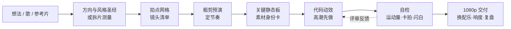

<div align="center">


# S17 艺术动效 · s17-motion-art

**用代码做 PV、预告片和动态字：逐帧精确、卡着拍点、随时可改。一个 Claude Code 技能，自带 106 个现成特效。**

[](LICENSE)
[](https://code.claude.com/docs/en/skills)
[](https://saikizhou-cyber.github.io/s17-motion-art/)
[](https://www.remotion.dev/)
[](#-实测不靠承诺)

[**在线画廊**](https://saikizhou-cyber.github.io/s17-motion-art/) · [安装](#-一行安装) · [怎么用](#-怎么用) · [特效库](#-106-个现成特效) · [English](README.en.md) · 中文


<sub>都是特效库自带演示的真实渲染。[到在线画廊看它们全部动起来。](https://saikizhou-cyber.github.io/s17-motion-art/)</sub>

</div>

---

## 为什么做这个

大多数 AI 视频工具给你的是一段改不了的片子：想改一个字，就得重新生成。这个技能反过来：**动效就是代码**（由帧号驱动的 React 组件，用 [Remotion](https://www.remotion.dev/) 渲染），每一个切点、缓动、颜色都能改，每次渲染结果一模一样。AI 只用在代码画不好的地方：角色、道具、底图这类静态图，而且只在你自己没有素材时才用。

- **从想法或一首歌到成片。** 三个创意方向、风格圣经、按拍点切好的镜头清单、粗剪预演，再到成片和带自动质检的 1080p 交付。
- **卡着音乐剪。** 先量出音乐的节拍网格，每个镜头都按网格规划，成片出来后检查有没有静止、闪白和跑偏的切点。
- **一个真正的特效库。** 106 个转场、动态字、镜头、后期、HUD 和剪辑节奏特效，可以直接放进任何 Remotion 工程，每个都是帧号的纯函数。
- **1:1 复刻参考片。** 把参考视频的切点、配色和运动（缓动、弹簧拟合、透视深度）量出来，用你自己的角色、文案和美术重建它的结构。

## 🚀 一行安装

```bash
git clone --depth 1 https://github.com/saikizhou-cyber/s17-motion-art.git "$HOME/.claude/skills/s17-motion-art"
```

bash 和 PowerShell 都能用。只给某个项目用：clone 到项目里的 `.claude/skills/s17-motion-art`。装好后输入 `/s17-motion-art`，或者直接说"帮我做一条 PV""1 比 1 复刻这条视频"，它会自动加载。其他能读取 Agent Skills 格式（`SKILL.md`）的编程代理：把这个文件夹放进它们的 skills 目录（未逐一测试）。

**依赖**：Node.js 18+、[ffmpeg](https://ffmpeg.org/)（含 ffprobe）、Python 3.10+（`python -m pip install pillow numpy scipy`；macOS/Linux 上用 `python3`）。可选：[rembg](https://github.com/danielgatis/rembg)（抠图）、即梦画布 CLI 或任何图片生成工具（只用来出静态素材）。文档里的命令按 POSIX shell 写，Windows 请用 Git Bash。工具默认按 **16:9、30fps、1280×720、合成名 `PV`** 工作；其他规格的参考片先转换：`ffmpeg -i in.mp4 -vf fps=30,scale=1280:720 -an reference.mp4`。

## 💬 怎么用

```text
/s17-motion-art 帮我做一条 30 秒的 PV：深夜电台里的 MC 对决，主角是我的原创角色（设定在 ./oc.md），
配乐 ./track.wav。先给我三个创意方向，选定后出镜头清单和粗剪预演。
```

```text
/s17-motion-art 1:1 复刻 ./reference.mp4 的镜头结构和节奏，角色换成 ./cards/ 里的角色卡，Logo 自己设计。
```

只想用特效库，在任何 Remotion 工程里：

```bash
python ~/.claude/skills/s17-motion-art/library/gallery/pick.py ink-blot,slam-text --to src/s17
```

它只复制你点名的特效（连同它们引用的辅助文件），并打印需要装的 npm 包。

过程中可以这样说：

```text
量一下原片第 785–805 帧那个飞入字的运动，直接给我 Remotion 代码
S30 到 S33 是同一个人物，前后大小位置要一致
把配乐换成 ./my-music.wav，不要重渲，并检查切点还卡不卡拍
扫一下成片，有没有原片没有的静止和闪白
```

它**不是**一键出片：方向、粗剪、关键静态板都要你点头，最终质量取决于你的要求和返工轮数。

## ✨ 四种模式

| 模式 | 你给它 | 它做出 |
|---|---|---|
| **创意 create** | 一句话、一个世界观或一首歌 | 三个对比鲜明的创意方向 → 风格圣经 → 按拍点切好的镜头清单 → 粗剪预演 → 成片 |
| **还原 realize** | 你的角色、道具、场景 | 每个素材一张"身份卡"（含三栏角色设定图提示词），出图自动对照，不走样 |
| **复刻 rebuild** | 一条参考视频 | 切点、配色、运动全部量出来，用原创内容 1:1 重建结构和节奏 |
| **交付 deliver** | 做好的工程 | 分段渲染 1080p、换配乐不重渲、响度标准化、自动质检、复盘 |

**它的核心是"量出来，写成代码"：**
- `motion_fit.py` 把参考片里一个元素的运动，直接反推成能贴进 Remotion 的 `interpolate` 缓动或 `spring` 弹簧参数，透视飞入按深度拟合，还能看出"一拍二"。
- `beat_check.py` 测音乐的拍点网格，检查切点是否落在重音上。
- `film_scan.py` 扫出成片里原片没有的静止、黑帧、闪白，以及比原片"更死"或"更躁"的镜头。

## 🧩 106 个现成特效

全部是代码，逐帧确定，按 720p 单位写、任意分辨率都能用。不限于 Remotion 自带的包：three.js、GSAP、anime.js、Lottie、WebGL、canvas 都能用，只要动画由帧号驱动。**[到在线画廊把它们全部看一遍 →](https://saikizhou-cyber.github.io/s17-motion-art/)**

<table>
<tr>
<td width="50%" align="center"><br><b>转场（23）</b><br><sub>撞击硬切、故障撕裂、墨迹蔓延、天鹅绒幕布、碎玻璃、网点擦除、CRT 关机、VS 撞屏……</sub></td>
<td width="50%" align="center"><br><b>动态字（21）</b><br><sub>砸字、逐字级联、解码、分离翻板、数字滚轮、RGB 疾冲字、类型墙、文字化为尘土……</sub></td>
</tr>
<tr>
<td align="center"><br><b>镜头（13）</b><br><sub>抖动、冲压变焦、手持漂移、希区柯克变焦、视差分层、拉焦、子弹时间、Kanada 透视甩入……</sub></td>
<td align="center"><br><b>后期与打击（22）</b><br><sub>RGB 分离、故障、VHS、CRT、胶片颗粒、半调网点、渐变映射、墨线描边、冲击波、ASCII 字符化……</sub></td>
</tr>
<tr>
<td align="center"><br><b>图形与 HUD（18）</b><br><sub>速度线、放射爆发、碎片喷射、彩带、HUD 边框、锁定准星、遥测读数、SVG 形状变形……</sub></td>
<td align="center"><br><b>剪辑节奏（9）</b><br><sub>预告片开场、卡点加速、黑场砸下、闪光定格、变速定格、顿帧、一拍二切换……</sub></td>
</tr>
</table>

用 `python library/gallery/pick.py <id>,<id> --to src/s17` 只复制用到的特效，再改参数。索引和用法见 [`library/README.md`](library/README.md)，每一类的详细说明（画面、用法、参数、注意事项）在 `library/catalog/`。有些特效带一条"注意"，都是渲染实测过的，比如命中点在第几帧。

来源：从 MIT / Apache-2.0 许可的优质项目里移植（54 个文件保留原作者版权头，许可全文见 [`THIRD_PARTY_NOTICES.md`](THIRD_PARTY_NOTICES.md) 和 `LICENSES/`），其余是原创，或只借鉴了思路、自己重写。

## 📏 实测，不靠承诺

- **逐帧精确：** 同一帧重复渲染，89 个特效像素完全一致，其余 17 个最多差 2 个亮度级（抗锯齿取整），没有哪个依赖渲染顺序。`npm run lint` 会拒绝 `Math.random`、`Date`、定时器和 CSS 动画。
- **对照"没有这个技能"：** 同一份 12 秒简报做了两轮盲评，评审只看成片，两种观看顺序都选了用这个技能做的那一条。没用技能的那条成片带了约 43 ms 的音画延迟、没有颜色标签的全范围视频和发灰的闪白帧，这些正是技能里的检查（`audio_offset.py`、像素格式检查、`film_scan.py`）要拦住的。注意：只有一份简报、各跑一次、评审是模型。
- **一个真实项目：** 36 秒的游戏联动 PV（57 个镜头、8 幕），交付 1080p，账本如下。

| 项目 | 该项目实测 |
|---|---|
| 全程 / 活跃时间 | 66.7 小时 / 18.8 小时（活跃时间含 AI 自己跑的时间） |
| 用户发的消息 | 113 条（44 条带截图） |
| 模型轮数 / 输出 token | 11,467 轮 / 1,342 万（主控以 Opus 为主、后期部分改用 Sonnet；子代理后期全部改用 Sonnet） |
| AI 生成（静态素材为主） | 121 张图 + 9 段视频 = 1,184 即梦积分（按生成数反推） |
| 白花的 | 9 段 AI 视频里 5 段没用上 → 所以现在动效一律用代码做，AI 只出静态图 |

完整复盘见 [`references/case-study-gamepv.md`](references/case-study-gamepv.md)。

<div align="center">

<br><sub>上图是那条 PV 的片段，演示复刻模式：镜头结构、节奏和后半段的特效构图（楔形字、碎片、白色结尾）按一条商业 PV 1:1 学习复刻；角色、名字、文案为原创，角色图由 AI 生成，所有动效由代码实现。</sub>
<br>
</div>

## 🧭 流程



七条铁律（详见 [`SKILL.md`](SKILL.md)）：

1. 动效就是代码，且逐帧确定；AI 只出静态素材。
2. 只做原创：不生成、不抠取、不描摹、不模仿任何已有 IP 的角色、Logo、字标或标题组合字样、UI 皮肤、标志性道具、定制字体、歌词或音乐。
3. 先静后动：方向、粗剪、关键静态板确认后才写动效；高潮先做。
4. 量出来，不目测：画面、运动、音乐、成片都有测量工具；同一人物跨镜头只用一组位置参数。
5. 做的人不评自己：子代理用中档模型干活，评审只看成片、两版对比交换顺序、修改附前后对比图。
6. 花钱之前先报预算。
7. 没验证就不说"完成"。

## 🧰 工具箱（`scripts/`）

| 用途 | 脚本 |
|---|---|
| 测量 | `frame_measure.py`（抽帧、取色、色块、外框、IoU）· `motion_fit.py`（运动 → Remotion 缓动/弹簧代码）· `cut_detect.py`（自动切点 + 带帧号复核图） |
| 和参考片对照 | `compare.py` · `shotsheet.py` · `grid.py` · `strip.py` · `side-by-side.mjs`（只在本地看）· `contact_sheet.py`（没有参考片时看成片） |
| 音乐与节奏 | `beat_check.py`（拍点网格、切点卡拍检查）· `audio_offset.py`（音画同步）· `animatic.py`（静态板 + 音乐 → 粗剪预演） |
| 静态素材 | `cutout.py` · `cleanedge.py` · `bluekey.py` · `hairfix.py` · `irisglow.py`（只是针对一个角色的示例：改里面的颜色常量）· `jm.py` · `jimeng_batch_run.py` · `jimeng_video_run.py` |
| 渲染与质检 | `render-chunks.mjs`（分段渲染、拼接、换配乐、响度）· `film_scan.py`（静止、黑帧、闪白、逐镜头运动量对比） |
| 复盘 | `transcript_stats.py`（用时、消息、各模型 token） |

命令都在 [`references/pipeline-recipes.md`](references/pipeline-recipes.md)。

## 🧠 踩坑精选

- **"神似"不等于 1:1。** 早期镜头被反复退回 → 现在运动用 `motion_fit.py` 量出参数，不再凭眼睛调缓动。
- **同一个人物在相邻三个镜头里忽大忽小**，返工四轮 → 一个共享常量管整段。
- **AI 视频动作不对、人物被裁**，9 段里白做 5 段 → 动效改用代码，AI 只出静态图。
- **14 个代理并行搭建撞上用量上限，结果全空** → 分批，每批独立落盘。
- **整片一次渲染在第 725 帧卡死** → 分段渲染；分段是静音的，换配乐只要 5 秒重新混音。
- **一个镜头悄悄静止了将近 1 秒，逐镜头对照时没人发现** → `film_scan.py` 自动扫出来。
- **自家品牌的字标照着原片 Logo 的造字方式做了** → 公开前逐个检查字标、徽章、特效形状有没有"长得像原作"。

## ❓ 常见问题

**要会写代码吗？** 代码由 AI 写；你需要会装 Node 和 ffmpeg、会看对照图和粗剪提意见。

**必须用即梦吗？** 不用。AI 只用来出静态素材，任何图片生成工具都行；你自己有素材就完全不用 AI。

**能复刻带版权角色的视频吗？** 可以拿它的镜头结构和节奏做学习、个人研究；角色、Logo/字标、界面样式、歌词、音乐和描出来的图形必须全部原创。只换名字不等于规避侵权，公开发布前请自己评估风险。这个 Skill 会拒绝生成、抠图、描摹或模仿受保护的内容。

**要多久、多少钱？** 参考上面的账本。纯代码动效的镜头不花积分；带角色图的镜头按静态图张数估。Claude 用量要单独算：那个项目用了 1,342 万输出 token，中途 5 次触到用量上限，建议先拿几个镜头小规模试跑。

**Remotion 收费吗？** 个人、3 人以内的营利公司和非营利组织免费（可商用）；超过 3 人的公司需要购买公司许可，以 [Remotion 官方许可](https://www.remotion.dev/license) 为准。

## 📁 目录结构

```text
s17-motion-art/
├── SKILL.md                      # 总入口：四种模式、七条铁律、工具表
├── references/
│   ├── create.md                 # 创意：三方向、风格圣经、拍点分镜、粗剪预演、反 AI 味守则
│   ├── asset-cards.md            # 还原：角色/道具/场景身份卡与提示词模板
│   ├── rebuild.md                # 复刻：拆片、测量、逐镜头对照
│   ├── deliver.md                # 交付：渲染、配乐、质检、打包、复盘
│   ├── pipeline-recipes.md       # 所有命令
│   └── case-study-gamepv.md      # 真实项目：用时、token、积分、踩坑
├── library/                      # 106 个现成动效：core/ 共用件、effects/ 按类别、catalog/ 分类说明、previews/ 缩略总览、gallery/ 检查、pick.py 和 demos.mjs
├── scripts/                      # 23 个工具脚本 + 共用模块 _shots.py
├── assets/                       # README 用的图
├── LICENSES/Apache-2.0.txt       # 移植自 Apache-2.0 项目的代码所附许可全文
└── THIRD_PARTY_NOTICES.md        # 第三方代码许可（cut_detect.py + 动效库里 54 个移植文件）
```

## 🤝 参与贡献

欢迎提 Issue 和 PR，见 [CONTRIBUTING.md](CONTRIBUTING.md)。最有用的贡献：新增一个特效（一个文件、逐帧纯函数、带演示，`npm run lint` 会检查）、你用某个特效时踩到的坑（写成"注意"），或者修一条按文档跑不通的命令。在 Issue 里分享你做的作品，也能让更多人看到它能做什么。

## ⚖️ 原创与版权

- 本仓库只包含流程、工具和演示画面，不包含任何参考视频的画面、音乐或原作角色；与任何游戏、动画或品牌的权利人无关联，也未获其授权或背书。
- 案例研究的演示画面是对一条商业 PV 镜头结构和特效构图的学习性复刻，角色、名字、文案为原创，图像由 AI 生成。
- 镜头构图、节奏、Logo/字标、界面样式和描摹出的图形仍可能受版权、商标或反不正当竞争法保护：这些都要自己重新设计，不要描摹，也不要使用原片音乐。公开发布或商用前请自行评估，必要时取得授权。本文不构成法律意见。
- `assets/` 里的图只用于说明本项目，不在 MIT 授权范围内。

## 📄 License

代码与文档：[MIT](LICENSE)（`assets/` 除外）。`scripts/cut_detect.py` 和 `library/effects/` 里移植过来的文件保留各自原作的许可（MIT 或 Apache-2.0），逐项列在 [`THIRD_PARTY_NOTICES.md`](THIRD_PARTY_NOTICES.md)，Apache-2.0 全文在 `LICENSES/`。依赖的 Remotion、rembg、ffmpeg 和各家生成服务有各自的许可和条款。

---

<div align="center">
如果这个 Skill 帮到了你，点个 ⭐ 让更多人看到。欢迎提 Issue 分享你做的作品。
</div>
