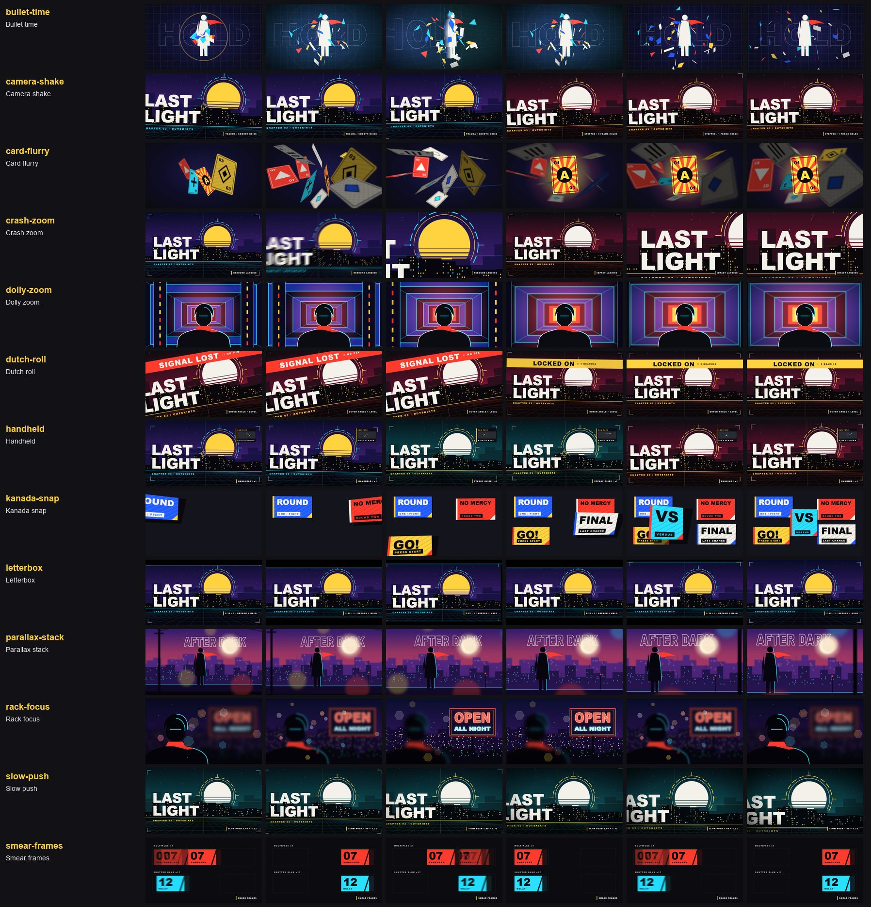

# Camera (13)

Back to the [library README](../README.md).

| id | what you see | when to use | export and props | source |
|---|---|---|---|---|
| `bullet-time` | The burst freezes mid-air while the camera yaws 55 degrees around it through 3D layers, hovers, swings back, and time resumes. | The hit that deserves a second look: an impact, a jump, a reveal; pairs with a bass drop. | `BulletTime` freezeAt?, orbitIn?, apex?, orbitOut?, angle?, perspective?, zoom?, sway?, tint?, flash?, backdrop? | own code, idea only |
| `camera-shake` | The whole frame jolts on each hit: either smooth noise on x / y / roll that starts violent and dies gently (trauma squared), or hard 1-frame offsets from a decaying table. | Impacts, drops and stingers on a beat: wrap the scene and list the hit frames. | `CameraShake` hits?, mode?, strength?, decay?, maxShift?, maxRoll?, frequency?, kick?, overscan?, seed? | ported (Apache-2.0) |
| `card-flurry` | Ten cards burst out of the centre and tumble through a 3D field, near ones dark and soft, backs flashing as they turn; one swings to a stop face-on in a glow. | Gacha pulls, character rosters, deck and inventory reveals; any "many things, then the one" beat. | `CardFlurry` cards?, count?, seed?, cardSize?, colors?, spin?, drift?, renderFace?, depthBlur?, focusZ?, light?, every?, enter?, hero?, ... | original |
| `crash-zoom` | The wide shot slams into a close-up on a chosen point in 6 frames with radial speed blur, then lands with an elastic overshoot or a dead stop and a decaying shake. | Reveal beats: the hero, the logo, the weapon. Hold wide for a beat before it and close for a second after. | `CrashZoom` start?, frames?, from?, to?, focus?, landing?, overshoot?, settle?, shake?, blur?, shutterAngle? | ported (Apache-2.0) |
| `dolly-zoom` | The hero holds one size while the corridor behind swells 1.9x and pylons rush outward: the camera backs off as the lens zooms in. | The moment a character realises something; a reveal that should feel like the floor dropping away. | `DollyZoom` background, subject, midground?, start?, frames?, fromDistance?, toDistance?, backgroundDepth?, midgroundDepth?, ease?, focus?, blur?, vignette? | own code, idea only |
| `dutch-roll` | The whole frame hangs at -10 degrees with a slow drift, then rolls past level and settles dead flat on the beat. | Unease that resolves: the problem shot, then the answer; a cut-in on a character coming back to their senses. | `DutchRoll` angle?, levelAt?, rollFrames?, settleFrames?, overshoot?, drift?, driftPeriod?, tiltIn?, overscan? | ported (Apache-2.0) |
| `handheld` | The frame drifts and tilts like a shoulder-held camera: three octaves of smooth noise on x, y and roll, with presets for a steady glide and a running bob. | Take the tripod off a static scene: documentary beats, chase and horror shots, anything that should feel filmed. | `Handheld` amount?, speed?, rig?, ramp?, overscan?, seed? | own code, idea only |
| `kanada-snap` | Five panels in a row each whip in from a fisheye 3D pose (turned ~60 degrees, 1.5x, 320 px lens) and snap flat in 18 frames, swing 5 degrees past, shake and drop a hard shadow. | Title cards, UI panels and character cards that must land with attitude on a beat. | `KanadaSnap` from?, inFrames?, fromPerspective?, toPerspective?, fromAngle?, fromScale?, fromOffset?, overshoot?, overshootFrames?, shake?, shakeFrames?, blur?, shadow?, shadowLength?, ... | own code, idea only |
| `letterbox` | 2.35:1 bars slam in from top and bottom with a hairline halo on their inner edges, flick open for one glitch frame, and slam away. | Switch a PV into "cinematic" for a hero beat or a trailer card, and back out for the gameplay montage. | `Letterbox` ratio?, inAt?, outAt?, inFrames?, outFrames?, stagger?, color?, halo?, haloOpacity?, haloRanges?, breach? | original |
| `parallax-stack` | Seven depth layers (sky to foreground) slide at different speeds as the camera pans right and pushes in 1.45x, with depth blur and haze. | Bringing a painted key art or a layered character shot to life; establishing shots and title backgrounds. | `ParallaxStack` layers, moves?, reach?, focusDepth?, depthBlur?, shake?, haze?, hazeAmount? | own code, idea only |
| `rack-focus` | The foreground bust goes soft as the neon sign behind it sharpens, hexagonal bokeh discs swelling and shrinking with the pull, then it racks back. | Moving attention inside one shot: from the character to what they are looking at, or back. | `RackFocus` near, far, keys?, maxBlur?, breathing?, dim?, hunt?, bokeh? | own code, idea only |
| `slow-push` | The shot creeps in toward a focus point with a built-up start and a faint Lissajous drift, corners darkening as it goes; reversible as a pull-back. | Tension and reveals: the long beat before a drop, a character holding still, any hold that must not look frozen. | `SlowPush` from?, to?, focus?, follow?, duration?, easeIn?, easeOut?, drift?, driftRatio?, driftPeriod?, vignette? | own code, idea only |
| `smear-frames` | A card whipped across the frame drags four countable ghost copies that merge into it on landing; the lane below uses a dense shutter blur instead. | Whip moves, card slams and fast cuts: give a one-or-two frame move a drawn-by-hand smear instead of a flat jump. | `SmearFrames` mode?, samples?, shutter?, opacity?, falloff?, window?, collapse?, intensity? | ported (Apache-2.0) |
