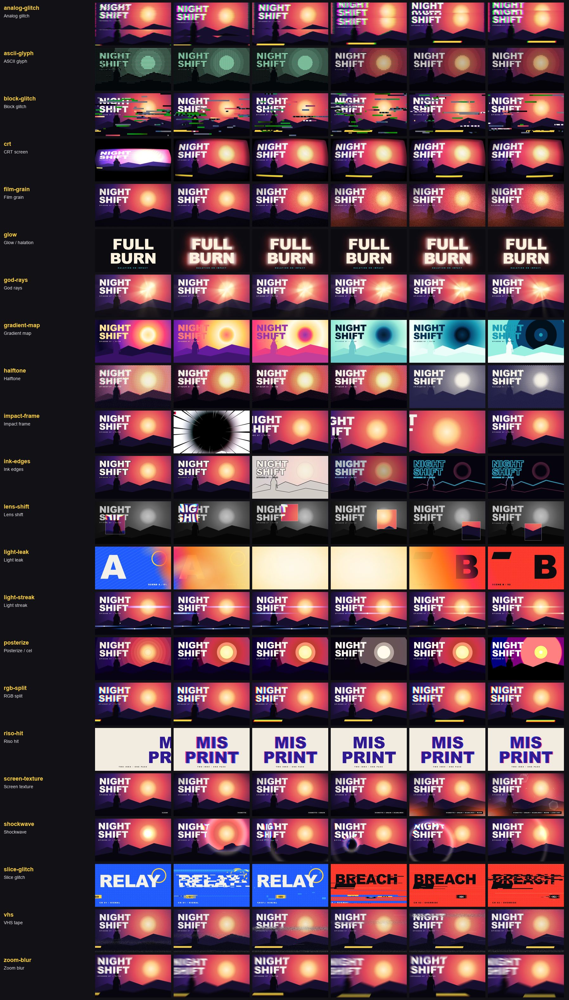

# Post FX and hits (22)

Back to the [library README](../README.md).

| id | what you see | when to use | export and props | source |
|---|---|---|---|---|
| `analog-glitch` | Scan-line strips tear sideways, the picture rolls up the screen and a green fringe snakes down it, in short bursts. | Signal-loss beats: a hacked screen, a corrupted flashback, the hit before a cut. Drive it with glitchBursts(). | `analogGlitch` | ported (MIT) |
| `ascii-glyph` | The picture re-printed as terminal characters, each cell choosing the glyph whose shape fits its tones and edges (strokes follow outlines); mono phosphor or tinted by the scene. | Hacker / terminal / system-scan look for a flashback, a data feed or a reveal; animate cell from big to small for a picture that resolves into detail. | `asciiGlyph` cell?, color?, background?, contrast?, edge?, gain?, weight?, backdrop?, amount? | ported (MIT) |
| `block-glitch` | Wide rectangles jump to other parts of the picture, flip to green/magenta, or show the scene a few frames ago. | Data-corruption hits: a system breach, a cut that must feel broken, a boss reveal. Fire it with glitchBursts(). | `blockGlitch` intensity, seed, grid?, periods? | ported (MIT) |
| `crt` | The picture opens from a bright line into a barrel-bent glass with scanlines, RGB phosphor stripes, bloom and a dark rim. | Footage shown on an in-world monitor, arcade / retro sections, a power-on or power-off beat. | `crt` | own code, idea only |
| `film-grain` | Boiling grain that clumps like emulsion, strongest in the mid-tones, with a vignette and a warm glow in the lower corners. | The last layer on almost any shot: ties CG, 2D and type into one filmic picture. Raise it for flashbacks. | `filmGrain` | original |
| `glow` | Three blurred, brightened copies sit under the element and screen onto the backdrop; on a hit the wide layers swell and flare at full strength, fall over 20 frames and settle into a soft steady glow while the element punches. | Neon text, logos and hero props; the bloom that follows a slam or a beat hit. **watch out:** Give its parent a real size (a full-frame container or a `<Place>` box): in an absolutely positioned div without width and height its root is 0 x 0 and the halo drifts off the element (measured +45 px / +12 px). | `Glow` hits?, color?, halation?, radius?, boost?, intensity?, rest?, idle?, pop?, popScale?, fall?, settle?, punch?, flicker?, ... | ported (Apache-2.0) |
| `god-rays` | Warm light shafts fan out from the light, cut by the mountains and the figure, and sharpen from a soft radial smear into a rotating hard-edged sunburst. | Reveal shots, dawn / backlit hero beats, a portal or relic lighting up; animate exposure on a snap curve for the ignition. | `godRays` light?, threshold?, samples?, density?, decay?, weight?, exposure?, tint?, shafts?, rayCount?, time?, spin?, sourceRadius?, amount? | own code, idea only |
| `gradient-map` | The whole picture re-inked in a 2..6 colour ramp by luminance: indigo-pink-gold, then a colour swap to ice, with the ramp sliding over the image and a final 5-band poster step. | Duotone / tritone looks, per-scene colour identity, heat-vision or flashback grades; animate offset for colour cycling. | `gradientMap` colors?, offset?, frequency?, repeat?, space?, bands?, scatter?, black?, white?, amount? | ported (MIT) |
| `halftone` | The scene re-printed as rotated CMYK (or RGB, one-ink dot, ruled line) screens; plates pull into register as the dots grow in. | Comic / retro-print look for a flashback or a stylised hit; animate dot 0 -> 1 and misregister -> 0 for ink-in. | `halftone` mode?, preset?, size?, dot?, smoothing?, angle?, black?, contrast?, misregister?, amount?, paper?, ink? | ported (MIT) |
| `impact-frame` | A 6-frame crash zoom slams into the target, then for exactly 3 frames the picture flips to a high-contrast black-and-white negative with 30 radial speed lines and a red/cyan fringe, and snaps back with a decaying shake. | The punch of a strike, a reveal or a drop: one per hit, never longer than 3 frames. | `ImpactFrame` at?, frames?, zoom?, approach?, release?, target?, lines?, lineWeight?, shake?, split?, contrast?, ink?, paper?, seed? | ported (Apache-2.0) |
| `ink-edges` | Pen-ink lines snap onto every contour, the colour falls away to leave line art on paper; then a second shot redraws the scene as pink-to-cyan neon contours on black. | Comic / anime outline over any scene, a blueprint or sketch reveal, neon wireframe for a hacker or night-city beat. | `inkEdges` mode?, strength?, thickness?, amount?, color?, lineOnly?, paper?, color1?, color2?, background?, opacity?, glow?, threshold?, intensity? | ported (MIT) |
| `lens-shift` | The picture sinks to a grainy, gently waving grey while a square lens glides over it and shows the scene in full colour, bulged toward the rim with a radial RGB split. | Pick out one detail (a clue, a face, a HUD element) as a tracking viewfinder; drive center with lensPath() and widen rgbShift while the lens moves. | `lensShift` center?, size?, distortion?, rgbShift?, waveFrequency?, waveStrength?, waveSpeed?, grain?, desaturate?, dim?, outline?, outlineColor?, time?, seed? | ported (MIT) |
| `light-leak` | A band of hot-pink, orange and gold light sweeps in from the edge, burns out to near-white at the peak while the cut happens underneath, then drains away in a soft tail. | Hide a cut with a film-burn flash, a warm memory / flashback beat, a soft intro or outro; place the cut inside the hold around `peak`. | `lightLeak` progress?, durationInFrames?, peak?, hold?, colors?, core?, seed?, angle?, intensity?, wash?, blend?, slit? | own code, idea only |
| `light-streak` | Every bright point in the frame snaps out a long horizontal anamorphic streak, white-hot at the core and fading to blue (then amber) in the tails. | Cinematic flare on lamps, neon, sun glints and muzzle flashes; a moving light drags its streak with it. Animate length with a snap curve on a hit. | `lightStreak` length?, threshold?, intensity?, tint?, tintAmount?, spread?, angle?, falloff?, soft?, taps? | own code, idea only |
| `posterize` | The picture crunches from smooth tone down to four flat cel bands that keep their own hue, drains to a pure tone ramp, comes back, then switches to a 3-step-per-channel colour crush. | Cel-shaded look for a character or a stylised cutscene; the fast levels crunch is a hit / flashback transition; pair with ink-edges for comic outlines. | `posterize` mode?, levels?, chroma?, curve?, dither?, shadow?, light?, tint?, amount? | original |
| `rgb-split` | Red and blue ghosts jump apart on a beat (any angle, or radial from the centre) and ease back, green stays put. | Every hit in a hype PV: on a downbeat, a title slam, a cut; keep amount 0 in between. | `rgbSplit` | original |
| `riso-hit` | On impact the element splits into a pink and a blue single-colour plate that multiply and swing in opposite directions with a decaying offset, then snap into register with a small scale pulse. | Print-flavoured titles and logo stings; a second, harder hit on the next beat. | `RisoHit` hits?, plates?, amplitude?, angle?, period?, decay?, duration?, escalate?, pump?, register? | ported (Apache-2.0) |
| `screen-texture` | Stepped film grain (a new pattern every 2nd frame), soft or hard scanlines that crawl, a radial vignette, warm lower-corner falloff and optional lens dirt, as one DOM overlay; the demo adds one layer at a time. | The last layer over a whole sequence to glue it together; heavier settings for CRT / found-footage moments. | `ScreenTexture` grain?, grainSize?, grainEvery?, scanlines?, scanSpacing?, scanScroll?, scanStyle?, vignette?, vignetteInner?, vignetteColor?, warm?, warmColor?, dirt?, dirtColor?, ... | original |
| `shockwave` | A bright refracting ring bursts from an impact point, bending the picture outward with a colour fringe as it races across the frame and fades; two hits, each with a punch-in. | Impact frames, explosions, power-up pulses, a drop on the beat; start one instance per hit and feed it (frame - hitFrame) / fps. | `shockwave` time?, center?, speed?, amplitude?, wavelength?, brightness?, maxRadius?, split?, rim?, rimColor? | ported (MIT) |
| `slice-glitch` | For 1-3 frames the picture breaks into horizontal bands and macroblocks that slide sideways, stretch and pull from the frames before and after, over a 50/50 ghost of the neighbour frame. | On a hard cut, a hit or a "signal lost" beat; art-direct bands per region for a shot-specific smear. | `SliceGlitch` events?, slices?, region?, sample?, offsets?, ghost?, lift? | original |
| `vhs` | Colour smears right off every edge, lines wobble, a noisy band crawls up and the bottom tears like a worn tape. | Found-footage and flashback shots, a retro-tech section, a recorded-message insert. | `vhs` | own code, idea only |
| `zoom-blur` | The picture streaks outward from a point, a fast dolly-in smear that snaps back sharp, with a faint colour fringe. | Punch-ins on a beat, whip into a title, impact on a character; set the centre on the subject. | `zoomBlur` | ported (MIT) |
