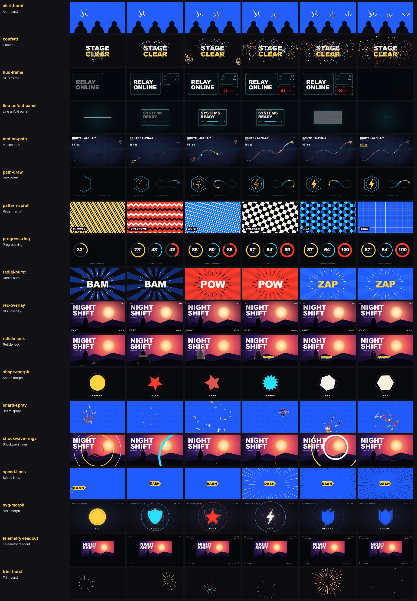

# Shapes and HUD (18)

Back to the [library README](../README.md).

| id | what you see | when to use | export and props | source |
|---|---|---|---|---|
| `alert-burst` | A fan of 2-5 sharp spikes radiates from a root point, pops in on stepped scale, then holds with beat kicks and a hand-drawn 6 fps boil; flat offset shadow. | A character notices something; "!" accents on a beat; also a tick fan as a hit mark on an icon. | `AlertBurst` x?, y?, preset?, spikes?, scale?, rotation?, flip?, color?, shadow?, shadowOffset?, kicks?, boilEvery?, boil?, stepFrames?, ... | original |
| `confetti` | Flat chips, strips and dots leave a cone, a point or two corner cannons at seeded speeds, lose speed to drag, then flutter down flipping and swaying; fades over the last 30 %. | Win / clear / unlock moments, release-date reveals, end cards; crossfire for a big finish. | `Confetti` mode?, count?, colors?, x?, y?, angle?, spread?, crossAngle?, power?, drag?, fall?, size?, lifetime?, cannonDelay?, ... | ported (MIT) |
| `hud-frame` | The panel fades in, then corner brackets / an octagon / a notched outline draw on from their corners with a bright spark on each head, and pips and ticks flicker on. | Boxes around game UI, status panels, character cards and any "system online" beat. **watch out:** Draws a dark panel (backgroundOpacity 0.74, measured: a bright picture drops to about a quarter) over whatever is behind it: set backgroundOpacity 0 for bare brackets over a picture. Pass your content as children: they draw above the panel and fade in with it. | `HudFrame` variant?, width?, height?, x?, y?, inset?, color?, accent?, background?, backgroundOpacity?, strokeWidth?, cornerLength?, cut?, inFrames?, ... | own code, idea only |
| `line-unfold-panel` | A white-hot line is pulled out of a point to both sides, the panel opens vertically and its content fades up; the exit squashes to a line, shrinks to a dot and blinks out like an old CRT. | Opening and closing UI panels, menus, mission cards or any screen that should power on and off. | `LineUnfoldPanel` width?, height?, x?, y?, delay?, outAt?, lineThickness?, hot?, background?, borderColor?, borderWidth?, glow?, scanlines? | ported (Apache-2.0) |
| `motion-path` | Three plane glyphs fly an S-curved route in formation with autoRotate, the route drawing itself just ahead of the lead, a tapered comet behind each plane, nodes lighting as the lead passes, and rings and a lock punch on the destination marker when they land. | Map routes, a squad moving to a target, missiles, paper planes, a card thrown across the frame. | `MotionPath` path, followers?, duration?, stagger?, delay?, ease?, drawRoute?, trail?, trailLength?, arrive?, marker?, waypoints?, spread?, size?, ... needs `gsap` | original |
| `path-draw` | SVG paths draw themselves on (staggered, in sync, one after another or scripted) with a fill that fades in after, or a tapered comet window with a bright head runs round them. | Logo and emblem build-ons, map routes, circuit lines, laser sweeps and light-trail loops. | `PathDraw` paths, viewBox?, mode?, sequence?, duration?, delay?, easing?, color?, colors?, strokeWidth?, linecap?, windowSize?, loop?, phase?, ... | ported (MIT) |
| `pattern-scroll` | A seamless full-frame graphic (stripes, chevrons, dots, checker, hex, grid, diamonds, truchet) scrolls at any angle and direction in one or two colours; optional ease-up from rest. | Moving backdrop under titles and character cards; a rhythmic wipe layer; a ramped scroll as a transition accent. | `PatternScroll` pattern?, background?, color?, color2?, size?, thickness?, angle?, direction?, speed?, ramp?, seed? | own code, idea only |
| `progress-ring` | A hard-edged conic ring (or round-capped stroke ring) fills with an eased curve while a bright frontier bar leads it and the centre number counts from the same value; a shock ring marks the end. | Loading / charge / sync-rate beats, stat reveals, "98 % complete" call-outs. | `ProgressRing` value?, displayValue?, suffix?, caption?, variant?, size?, thickness?, color?, trackColor?, textColor?, fillFrames?, delay?, easing?, ticks?, ... | ported (Apache-2.0) |
| `radial-burst` | A ring of 20 kite-shaped lines pops outward around a word on stepped radii with a ragged stagger, holds, fades; a slowly turning sunburst sits behind it. | Word and logo hits ("BAM"): the lines frame the hero from outside, unlike speed-lines (converging from the edges) or trim-burst (small sparks). | `RadialBurst` x?, y?, count?, innerRadius?, aspect?, radiusStep?, length?, lengthVariance?, weight?, popFrames?, stagger?, drift?, hold?, fadeFrames?, ... | ported (Apache-2.0) |
| `rec-overlay` | White mono camcorder text with a dark outline: red REC dot blinking about every half second, battery, date stamp, running HH:MM:SS counter and viewfinder corner marks. | Found-footage, security-cam and "recorded" beats; framing a flashback or a recon clip. | `RecOverlay` label?, date?, time?, mode?, startSeconds?, showFrames?, battery?, blinkSeconds?, color?, accent?, inset?, fontSize?, marks?, crosshair?, ... | ported (Apache-2.0) |
| `reticle-lock` | Four yellow L-brackets fly in oversized, close onto the target with an overshoot, a scan line sweeps it, then the brackets click shut with a flash, shock ring and label. | Spotting a character, a hit or an object: "found you" beats, tutorial call-outs, enemy intros. | `ReticleLock` target?, label?, sublabel?, color?, flashColor?, armLength?, thickness?, padding?, flyFrames?, lockFrame?, fromScale?, fromRotate?, scan?, labelSide?, ... | ported (Apache-2.0) |
| `shape-morph` | A solid shape melts into the next (circle, star, badge, hexagon, or any SVG path) with a colour mix, a swell and a twist while an outline echo turns the other way. | Logo and icon transformations, rank / tier changes, loot-rarity swaps and rhythmic shape cuts on the beat. | `ShapeMorph` shapes?, fills?, holdFrames?, morphFrames?, loop?, size?, spin?, twist?, punch?, ripple?, echo?, stroke?, strokeWidth?, points?, ... | own code, idea only |
| `shard-spray` | Sharp two-tone triangle shards are flung from a point along a seeded fan, braking hard, spinning and flipping, falling under gravity and shrinking out; a few long streaks lead. | Glass breaks, hit debris, screen-shatter accents; on twos for a cut-out look. | `ShardSpray` x?, y?, count?, angle?, spread?, distance?, size?, stretch?, gravity?, spin?, frames?, stepEvery?, colors?, shadeColor?, ... | original |
| `shockwave-rings` | On a hit a thick ring pops from a point (radius on expo-out), thins to a hairline as it expands and fades; 1-3 rings stagger, a pale echo trails the first frames. | Every impact on a beat: landings, punches, logo slams; centre it on the hit or push it off the frame edge for a blast from outside. | `ShockwaveRings` x?, y?, count?, stagger?, radius?, thickness?, hairline?, frames?, color?, colors?, hairlineOpacity?, echo?, step?, flash? | original |
| `speed-lines` | Focus: tapered rays rush in from the edges and snap onto a point in 3 frames, hold boiling, retract. Trail: a stretching element lands on a damped spring with streaks behind it. | Impact frames and reveals (start the focus 3 frames early so the snap lands on the beat); a fast fly-in with a hard landing. | `SpeedLines` mode?, from?, to?, x?, y?, count?, weight?, spread?, duration?, bounce?, squash?, tail?, streakLength?, taper?, ... | ported (MIT) |
| `svg-morph` | One emblem morphs through circle, shield, star, lightning bolt and crest on an even beat: the fill is tweened along, every arrival punches the scale with an elastic settle and a thin outline of the previous shape expands out from under it. | Emblem and logo transformations on beats, power-up icons, faction and rank symbols, a class-select cycle. | `SvgMorph` shapes, hold?, morph?, delay?, center?, type?, ease?, fills?, punch?, echo?, inner?, glow?, intro? needs `gsap` | original |
| `telemetry-readout` | Four corner brackets draw on, small mono label:value lines fade in around them, and every value scrambles through same-type characters that lock in left to right. | Debug-HUD dressing for tech / mecha / sci-fi shots; stat call-outs that must feel "live" but stay quiet. **watch out:** Defaults are small and dim (fontSize 19 = 12 px glyphs at 720p, muted 55 % white): raise them for a trailer. Each value stays scrambled until its cue + tickFrames (15): the 4 default readouts resolve on frames 31 / 36 / 41 / 46, so a 36-frame shot ends with 3 of 4 still scrambled. Pass cues / tickFrames that finish inside the shot. | `TelemetryReadout` readouts?, emphasize?, cues?, firstCue?, tickFrames?, steps?, seed?, color?, muted?, accent?, bracketColor?, brackets?, inset?, bracketSize?, ... | ported (Apache-2.0) |
| `trim-burst` | A ring of short strokes shoots out of a point, grows, travels and shrinks to nothing at its reach (outer end launches fast, inner end chases), dots popping ahead. | Pick-up / hit sparks, button pops, a small accent when a number or icon lands. | `TrimBurst` x?, y?, count?, innerRadius?, reach?, strokeLength?, weight?, rotation?, spread?, jitter?, dots?, cap?, color?, colors?, ... | ported (MIT) |
