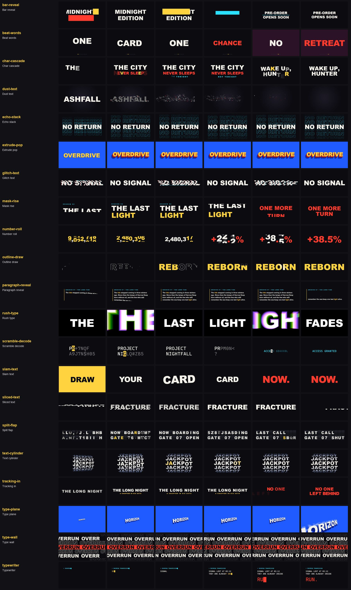

# Kinetic type (21)

Back to the [library README](../README.md).

| id | what you see | when to use | export and props | source |
|---|---|---|---|---|
| `bar-reveal` | A solid accent bar wipes across each line at line height in 8 frames, then moves on and leaves the text sliding into place in its wake; a second bar takes it away on exit. | Trailer titles, character name plates and release dates; the vertical variant for stacked taglines. | `BarReveal` text, barColor?, direction?, barFrames?, slideFrames?, hold?, overlap?, stagger?, slide?, exitAt?, color?, fontSize?, fontFamily?, letterSpacing?, ... | original |
| `beat-words` | One auto-fitted word on screen at a time, hard-cut on each beat frame; the entrance rotates (drop, slide left, slide right, pop, plus stomp, slam, flicker) and the held word keeps creeping in. | Lyric and slogan cuts on the music, hype montages, one-word-per-hit title sequences. **watch out:** `beats` are frames local to its `<Sequence>`, one per word, in order: subtract the Sequence start from the `beat_frames` you cut on. | `BeatWords` words, beats, endFrame?, entrances?, accentWords?, accent?, flash?, flashWords?, drift?, exitFrames?, color?, fontSize?, maxWidth?, fontFamily?, ... | own code, idea only |
| `char-cascade` | Each character rises 0.6 em while fading in and de-blurring on an expo-out curve, 2 frames apart; modes rise, drop and scale-stamp, ordered from the start, end, centre or at random. | Main title and sub-title reveals; any line that should arrive with weight but stay readable. | `CharCascade` text, mode?, from?, stagger?, maxSpread?, inFrames?, lineStagger?, distance?, scaleFrom?, blur?, flash?, color?, fontSize?, fontFamily?, ... | original |
| `dust-text` | A word drains to grey and crumbles through a noise threshold while small dust quads (and optional red petals) are born where the letters vanish, drift on the wind, rise and fade out. | A title or name that must die, fade from memory or be "taken": a character farewell, a chapter end, a countdown to nothing; hold the intact word first with delay. | `DustText` text, delay?, duration?, fontSize?, fontFamily?, fontWeight?, letterSpacing?, color?, ashColor?, dustColor?, particleCount?, dustSize?, life?, wind?, ... | ported (MIT) |
| `echo-stack` | One crisp line focuses in at the centre while cyan outline copies unfold above and below, squash toward the edge, fade and keep drifting like a drum. | A held title or tagline that needs life over a long shot; calm counterpart to the slam and glitch hits. | `EchoStack` text, fontSize?, fontFamily?, fontWeight?, color?, outlineColor?, outlineWidth?, copies?, reach?, fan?, drift?, unfoldFrames?, blur?, fitWidth? | own code, idea only |
| `extrude-pop` | A flat heavy word lifts off the page on a solid stepped extrusion with a stamp overshoot, then keeps breathing slightly. | Title and call-out words that should feel like a heavy block: stamps, logo-style lockups, big stats. | `ExtrudePop` text, fontSize?, fontFamily?, fontWeight?, face?, bodyNear?, bodyDeep?, edge?, shadow?, depth?, angle?, pops?, springConfig?, idle?, ... | original |
| `glitch-text` | The word stutters on held frames, jumps in horizontal slices with red / cyan ghosts and symbol flips, then locks clean; repeatable on beats. | Title cards that hit with a digital tear; emphasis hits on a beat; system-failure or corrupted-signal moments. | `GlitchText` text, fontSize?, fontFamily?, fontWeight?, color?, bursts?, burstFrames?, intensity?, hold?, ghostWarm?, ghostCool?, swapRatio?, scanlines?, stretch?, ... | own code, idea only |
| `mask-rise` | Each line swings up from behind its own invisible mask edge with a slight tilt and blur, lines 4 frames apart; the exit slides them up and out through the same edge. | Multi-line titles, credits and taglines that need a clean architectural reveal rather than a fade. | `MaskRise` lines, inFrames?, stagger?, from?, alternate?, tilt?, blur?, exitAt?, exitFrames?, exitStagger?, exit?, color?, fontSize?, fontFamily?, ... | original |
| `number-roll` | An odometer: each digit is a 0-9 strip that spins up and lands on its digit with a snap, places stopping left to right behind motion ghosts, the whole number popping when the last one locks. | Player counts, stats, damage and score reveals; prices and dates that should land with weight. | `NumberRoll` value, from?, decimals?, separator?, prefix?, suffix?, inFrames?, stagger?, spins?, pace?, overshoot?, settleFrames?, pulse?, ghost?, ... | own code, idea only |
| `outline-draw` | Glyph outlines trace themselves as a stroke letter by letter, then a fill wipes up inside each one and one diagonal sheen crosses the word. | Game title reveals and chapter cards that should feel hand-inked then lit; outline-only mode for ghost titles. | `OutlineDraw` text, fontSize?, fontFamily?, fontWeight?, letterSpacing?, color?, strokeColor?, strokeWidth?, drawFrames?, stagger?, fillAt?, fillFrames?, fillDirection?, strokeKeep?, ... | original |
| `paragraph-reveal` | A four-line lore paragraph climbs out of invisible line masks character by character (SplitText finds the real line breaks), two words glow yellow, then the lines slide out upwards one after another; also word-slide and character-flip modes. | Story text between hype shots, mission briefings, intro lore, subtitles and closing credits: any copy longer than one line. | `ParagraphReveal` text, mode?, stagger?, inFrames?, width?, fontSize?, fontFamily?, fontWeight?, lineHeight?, letterSpacing?, align?, color?, accent?, highlight?, ... needs `gsap` | original |
| `rush-type` | One word at a time: it arrives, rests sharp, then rushes at the camera leaving vertical red / green / blue shutter trails before the next word cuts in. | Rapid-fire taglines and hype lists over a flat plate; a loud word-per-beat section. | `RushType` words, fontSize?, fontFamily?, fontWeight?, color?, background?, arriveFrames?, holdFrames?, rushFrames?, rushScale?, trail?, lastStays?, fitWidth? | own code, idea only |
| `scramble-decode` | Wrong glyphs cycle through every character slot and resolve to the real text left to right, each lock flashing a block; the exit scrambles it away from the last character back. | Hacking, system and classified-file moments; codenames and location stamps. | `ScrambleDecode` text, charset?, lockStart?, lockEnd?, rerollEvery?, seed?, accent?, accentText?, flashFrames?, exitAt?, exitFrames?, color?, dimColor?, fontSize?, ... | own code, idea only |
| `slam-text` | A word drops from 2.6x to 1x in 6 frames with a rotation settle, a 2-frame flash card and a decaying shake. | One word per beat in a hype section; titles that must hit. **watch out:** The hit (a 2-frame flash card and the start of the shake) is on frame inFrames (default 6) of its `<Sequence>`, not on frame 0 (measured): start the Sequence inFrames before the beat. | `SlamText` text, inFrames?, fromScale?, fromRotate?, color?, flash?, shake?, fontSize?, fontFamily?, seed? | original |
| `sliced-text` | A huge word cut into uneven strips that slide in from alternating sides, land one after another, close their seams into a solid word and leave out of the opposite side. | Section titles and one-word statements that need weight; bold reveal with a clean lock-up. | `SlicedText` text, fontSize?, fontFamily?, fontWeight?, color?, altColor?, slices?, direction?, mode?, travel?, inFrames?, stagger?, gap?, holdFrames?, ... | own code, idea only |
| `split-flap` | An airport board: each character is a two-leaf card stepping along a drum alphabet, the upper leaf falling and the lower leaf landing with hinge shading, cells settling left to right. | Destination and time boards, scoreboards, countdown-to-location cuts; any line that should arrive mechanically. | `SplitFlap` text, from?, drum?, flapFrames?, flaps?, maxFrames?, cellStagger?, rowStagger?, seed?, landColor?, color?, topColor?, bottomColor?, fontSize?, ... | own code, idea only |
| `text-cylinder` | The word sits on every face of a lit 3D drum; each letter spins up from behind the screen one after another, brakes and settles on the front face with a rock-back. | Slot-reel / counter style title reveals; a word that must feel mechanical and lands on a beat. | `TextCylinder` text, fontSize?, fontFamily?, fontWeight?, color?, shade?, flash?, tracking?, falloff?, faces?, lineGap?, turns?, spinFrames?, stagger?, ... | own code, idea only |
| `tracking-in` | Letter-spacing collapses from 0.42 em to tight while the text fades in and sharpens (eased or a springy squeeze); hits pulse the tracking open and shut on the beat. | Cinematic title and tagline reveals; a kerning pulse on a sting or logo hit. | `TrackingIn` text, unit?, from?, to?, mode?, inFrames?, stagger?, blur?, rise?, hits?, pulse?, color?, fontSize?, fontFamily?, ... | original |
| `type-plane` | A heavy extruded word lies on a receding plane; a perspective camera dollies at its first letter, which explodes toward the lower left while the last letters hold. | Title hits on a push-in; a word that flies past the lens as a transition into the next shot. | `TypePlane` text, yaw?, roll?, fitW?, maxSize?, perspective?, fontFamily?, fontWeight?, face?, ext?, extDeep?, extDepth?, keys?, smear? | original |
| `type-wall` | Rows of one word fill the frame and scroll in opposite directions at different speeds, solid, outline and a colour band, surging and skewing on the beat. | Hype backdrops, chapter breaks and beat-synced title walls; a sustained filler behind a hero shot. | `TypeWall` text, rows?, rowHeight?, speed?, gap?, fontFamily?, fontWeight?, color?, accent?, accentInk?, outlineWidth?, beats?, surge?, skew?, ... | original |
| `typewriter` | Text types in left to right at a speed or on a [frame, count] schedule (a few characters, a held beat, then a burst) with a solid-while-typing blinking block cursor and a flash on each new character. | Terminal and system messages, subtitles, dialog lines, any line that should arrive as if being written. | `Typewriter` text, cps?, start?, schedule?, speed?, jitter?, pause?, seed?, cursor?, cursorColor?, blink?, cursorAfter?, flash?, flashFrames?, ... | original |
