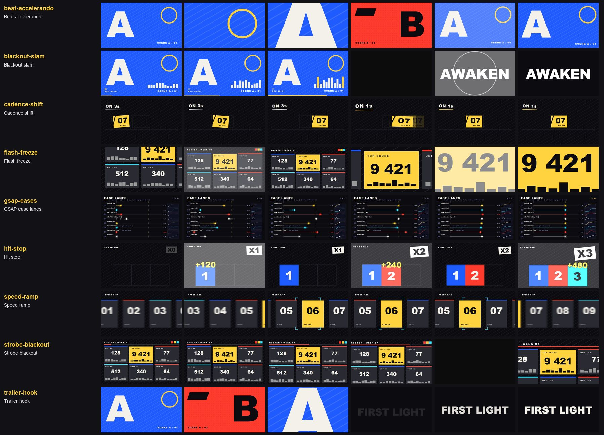

# Edit timing (9)

Back to the [library README](../README.md).

| id | what you see | when to use | export and props | source |
|---|---|---|---|---|
| `beat-accelerando` | Six framings hard-cut at shrinking intervals (49, 16, 12, 8, 6, 4 frames by default), the last cut slamming back to the master shot with a shake and a slow push-in. | Build-up into a title or a reveal; any section where the music speeds up and the edit has to keep pace. | `BeatAccelerando` shots, intervals?, beats?, framings?, master?, push?, pushFrames?, slam?, slamShake?, cutKick?, seed? | ported (Apache-2.0) |
| `blackout-slam` | Footage breathes along to a beat, cuts to 12 frames of dead black, then the title slams in from 1.35x with a shake, a flash and a ring. | The drop in a PV: silence before the title or the logo hit. Spread SMASH_CUT (black 0, lead "surge", no punch, shake, ring or flash) for the smash cut from roar to stillness. | `BlackoutSlam` slam?, word?, at?, black?, blackColor?, lead?, surge?, surgeRoll?, punch?, punchFrames?, shake?, ring?, ringColor?, flash?, ... | ported (Apache-2.0) |
| `cadence-shift` | A card crosses the screen in chunky 10 fps steps (on threes), then at frame 48 the same animation runs on ones: a silky sprint with stretch, afterimages, overshoot and settle. | Sakuga-style hits in an anime PV: choppy hand-drawn timing that breaks into smooth motion on the key moment; or film pulldown (fps) for retro footage. | `CadenceShift` on?, then?, switchAt?, holds? | ported (Apache-2.0) |
| `flash-freeze` | A slowly pushing shot, then three white camera flashes, each hard-cutting to a tighter crop (wide, card 2.3x, digit 4x) that drops and settles like shutter afterglow. | Spotlight moment: a score, a rank, a pull result or a character reveal presented as press photos. | `FlashFreeze` flashes?, views?, leadScale?, leadFocus?, settleFrames?, settleZoom?, settleDrop?, decay?, peak?, flashColor?, shutterShake?, seed? | ported (Apache-2.0) |
| `gsap-eases` | Eight lanes race one dot each from 0 to 1 with a different GSAP ease (power4.out, expo.inOut, back, elastic, bounce, a squashing CustomBounce, a hand-drawn CustomEase, steps) beside a curve thumbnail with a cursor and a live value readout; driven by interpolate(), not a timeline. | Picking an ease by eye; using GSAP's richer ease set (CustomEase, CustomBounce, steps) inside plain Remotion code via gsapEase(). | `EaseLanes` eases?, duration?, delay?, loop?, pause?, colors?, title? needs `gsap` | original |
| `hit-stop` | On each hit the whole picture freezes for 2 frames under a white flash and a shake, then thaws with a decaying scale and brightness pump. | Impact beats: a card slamming in, a sword hit, a title stamp. Put your own hit frames in; hitStopTime() keeps outside layers in step. | `HitStop` hits, stop?, flash?, flashPeak?, shake?, punch?, glow?, decay?, seed? | ported (Apache-2.0) |
| `speed-ramp` | The footage rushes past at 2.2x with motion blur, eases down to a crisp 0.2x window where the target crosses the centre, then speeds off again; freeze presets stop it dead on a hit. | Hero shots: gaze at the one card, move or face in a fast montage; ramp into a freeze-frame hit on the beat. | `SpeedRamp` speeds?, startFrame?, ease?, samples?, shutter?, blurAbove?, flash?, flashPeak?, flashFrames?, punch? | ported (Apache-2.0) |
| `strobe-blackout` | The picture creeps in while 2-frame black flashes come faster (8 frames apart, then 3), then a hard cut to a tight crop with a dark hammer pulse. | Tension build right before the drop or the reveal; pair it with a rising riser and keep it short (photosensitivity). | `StrobeBlackout` flashes?, flashFrames?, color?, push?, landing?, punch?, focus?, hammer?, hammerFrames? | ported (Apache-2.0) |
| `trailer-hook` | Three 9-frame shots hard-cut (wide, wide, 2.2x punch-in), each creeping 1 -> 1.04, then 6 frames of dead black and the title rises in. | Cold open before the main title of a PV; the speed-cut that sells a trailer in its first second. | `TrailerHook` shots, shotFrames?, framings?, drift?, black?, blackColor?, title?, titleFrames?, rise?, titleBackground?, titleColor?, fontSize?, fontFamily?, cutKick? | ported (Apache-2.0) |
