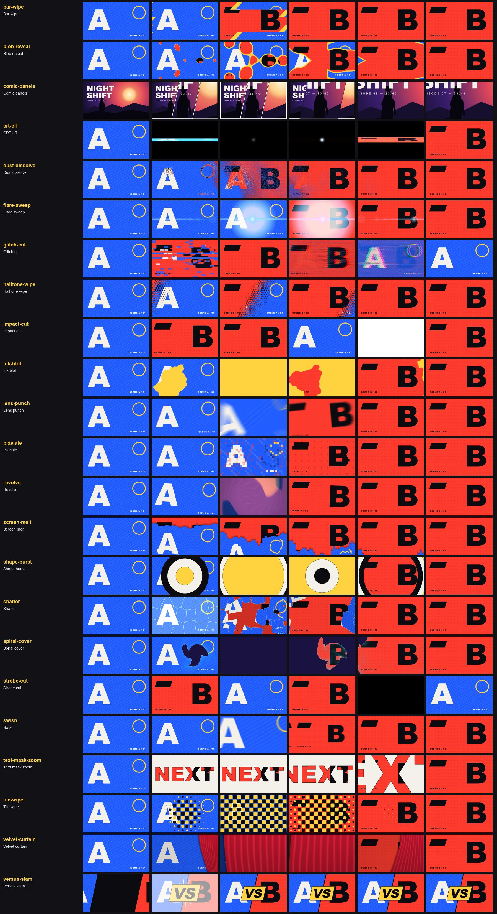

# Transitions (23)

Back to the [library README](../README.md).

| id | what you see | when to use | export and props | source |
|---|---|---|---|---|
| `bar-wipe` | Five slanted bars sweep across from the middle out, each led by a yellow band, revealing the next scene in ~18 frames. | Section changes in a hype PV; between character cards. | `barWipe` bars?, slant?, stagger?, accent?, accentWidth?, direction? | original |
| `blob-reveal` | A lumpy central blob and rings of satellite bubbles bloom out of the middle, their edges wobbling with a rotating wave and melting together, and the next scene fills in through them. | Soft, organic scene changes: slime / liquid / spore / bubble themes, a magic bloom, an eye-opening reveal, a character-select card swap. Raise wobble for goo, set edgeWidth 0 for a clean mask. | `blobReveal` wobble?, satellites?, merge?, softness?, edgeColor?, edgeWidth?, ease?, center? | ported (MIT) |
| `comic-panels` | The shot is cut into three slanted comic panels with paper gutters and ink outlines that slap in two frames apart as wide, close-up and detail angles; the middle one then swells over the page into the next shot. | Character intros, roster cards and "one hero, three angles" beats; also a manga-style way to open a new scene. Component around one picture, not a presentation. | `ComicPanels` views?, framings?, widths?, splitAt?, stagger?, pop?, expand?, expandAt?, expandFrames?, slant?, gutter?, outline?, margin?, paper?, ... | ported (Apache-2.0) |
| `crt-off` | The picture squashes to a bright horizontal line with red/blue fringing, pinches to a dot and dies to black; B then powers on from a dot through a line to full frame. | Power-down / reboot beats, game over to menu, a hacked-screen cut, retro-tech scene changes. | `crtOff` hold?, fringe?, gain?, afterglow?, phosphor? | ported (MIT) |
| `dust-dissolve` | The outgoing frame crumbles into fine square specks of itself, bright shapes and lettering first, that shrink and blow off downwind in a fan of streams while the next scene is uncovered behind a dark ash rim. | Loss, memory and death beats; a character crumbling out of a scene; title cards that turn to dust before the next act. | `dustDissolve` particleSize?, scatter?, shimmer?, aberration?, direction?, stagger?, lumaOrder?, spread?, density? | own code, idea only |
| `flare-sweep` | A thin blue anamorphic streak with a glowing core races in from the left, blooms to a full white-out at the midpoint where the shot changes, then streaks away to the right. | Sci-fi and night-city trailers, tech reveals, any cut that should feel like a camera passing a light. | `flareSweep` color?, y?, direction?, hold? | ported (MIT) |
| `glitch-cut` | The frame tears into horizontal slices with RGB split and block leaks and hard-swaps scenes inside the mess: a 14-frame light tear, then a 30-frame heavy datamosh burst with scanlines and strobe. | Cyber / sci-fi / corrupted-signal beats, a boss reveal, an "interference" cut on a drum hit. Use light for a snap, heavy for a full-second set piece. | `glitchCut` preset?, intensity?, steps?, slices?, rgbSplit?, blockNoise?, horizontalBars?, verticalSlits?, tear?, chroma?, residue?, noiseAmount?, scanAmount?, flashAmount? | ported (MIT) |
| `halftone-wipe` | A wave of ink-edged dots swells across the frame at 30 degrees, the new scene inside each dot, until the dots touch and merge into the full picture. | Comic / print-styled PVs, flashback-to-present cuts, anything that should feel like a halftone screen. | `halftoneWipe` columns?, angle?, edge?, edgeWidth?, spread? | ported (MIT) |
| `impact-cut` | Hard cut on the beat: the outgoing shot squeezes in, two flash frames hide the swap, the new shot lands punched in at 1.12x and shakes itself still. | Beat drops, smash cuts into the title, any cut that has to be felt. **watch out:** The swap (and the flash) happens at cutAt x duration, default 0.3, but transitionPlan() plans the cut at the middle of the overlap: with the default the flash starts 2 frames early on a 10-frame overlap (measured). Pass cutAt = floor(d / 2) / d (0.5 for an even d) to start it on the beat frame. | `impactCut` flash?, flashFrames?, punch?, settle?, shake?, cutAt?, windUp?, seed? | ported (MIT) |
| `ink-blot` | A coloured ink blot spreads from a point with a ragged, smoky edge until it swallows the frame, then a ragged hole opens from the same spot and pushes the ink out past the edges onto the next scene. | A hard scene change that wants a graphic, hand-made feel: title card to gameplay, chapter breaks, a hit or a blackout beat, ink / blood / paint themes. Set origin to where the action is. | `inkBlot` origin?, color?, ragged?, softness?, seed? | ported (MIT) |
| `lens-punch` | The old shot dives into a fisheye zoom with radial blur, roll and red/blue fringing, hard cut at the midpoint, the new shot settles out of the same distortion with a little handheld shake. | Impact cut on a hit or a drum fill: hero look-up to the next shot, gameplay to logo, anywhere a whip would feel too soft. | `lensPunch` outScale?, inScale?, outFov?, inFov?, outBlur?, inBlur?, outRoll?, inRoll?, rgbSplit?, shake?, anticipate?, letterbox? | own code, idea only |
| `pixelate` | The frame breaks into square blocks that tick up to a coarse 32 x 18 grid, blocks flip to the next scene around the midpoint, then the grid ticks back down to sharp. | Hard cut with a digital feel: hacking / system boot / glitch-y UI moments, or a retro game-menu to gameplay switch. | `pixelate` squaresMin?, steps?, scatter?, blend? | ported (MIT) |
| `revolve` | The frame whips around a point like a spinning camera: rotation, a core twist, zoom to 2.2x and motion blur, the scene swaps under the blur and unwinds into B. | High-energy action cuts, hero spin-to-ability moments, "world flips" beats in a hype PV. | `revolve` direction?, center?, maxRotation?, peakZoom?, swirl?, barrel?, motionBlur?, switchStart?, switchEnd?, shadow? | ported (MIT) |
| `screen-melt` | The old picture is sliced into 30 hard-edged columns that slide off the bottom at different speeds, the middle columns running ahead, exposing the next scene behind them. | Retro-game and horror beats, "the world is breaking down" cuts, or a cheeky wipe in a game-trailer montage. | `screenMelt` bars?, amplitude?, noise?, frequency?, dripScale?, seed?, edgeShade? | ported (MIT) |
| `shape-burst` | Ink, paper and yellow rings burst out of the centre one after another until yellow covers the frame, then burst back and open a hole onto the new scene. | Logo moments and section breaks with a toy-box or pop-art tone; swap colours to match the incoming scene. | `shapeBurst` colors?, origin?, shape?, hold?, edge?, edgeColor? | ported (MIT) |
| `shatter` | A crack flashes across the frame, then it splits into glass shards that burst outward from the centre, spinning and swelling past the camera to uncover the next scene. | Impact cuts: a hit that breaks the scene, a boss slam, a reveal where the old world is destroyed. | `shatter` cells?, seed?, origin?, spin?, grow?, edgeColor?, edgeGlow?, flash?, parallax?, backDim? | ported (MIT) |
| `spiral-cover` | A dark whirlpool of spiral arms with a smoky, glowing edge spreads from a point until it covers the frame, then a hole with the same glowing rim opens from that spot onto the next scene. | Portal, vortex or time-warp cuts: entering a dungeon or a rift, a magic or curse hit, a dream / memory jump. Tint glowColor to the spell. | `spiralCover` origin?, color?, glowColor?, hotColor?, arms?, twist?, spin?, ragged?, glow?, glowStrength?, softness?, seconds?, seed? | ported (MIT) |
| `strobe-cut` | The two shots flip back and forth, slowly at first then every frame, optionally with black frames between, and settle on the new shot. | Hype-section builds, glitchy beat-synced entries, a nervous cut before a reveal. | `strobeCut` flips?, blackFrames?, accel? | ported (MIT) |
| `swish` | Zoom-through: the old shot rushes into a single point at 5x with motion blur, cuts, and the new shot flies out as a mirror-tiled swarm that slows into one full frame. | Fast section changes, "dive into the map / screen" shots, power-ups, any jump that should feel like travelling through the picture. | `swish` zoom?, angle?, offset?, exponent?, blur?, frames?, wrap? | ported (MIT) |
| `text-mask-zoom` | NEXT slams onto a paper backdrop with the next scene visible only inside its letters; the camera then falls through the X until the new scene fills the frame. | Chapter titles, mode reveals and logo-to-footage cuts: the word is the doorway into the next scene. | `textMaskZoom` text?, zoomLetter?, background?, outline?, outlineWidth?, fontFamily?, fontWeight?, tracking?, fontSize?, focus?, maxScale? | ported (MIT) |
| `tile-wipe` | A 16x9 grid of rounded yellow and black tiles pops in from the centre outwards, each spinning up from nothing, snaps shut into a solid checkerboard over the old scene, then shrinks away from the edges inwards to uncover the new one. | Hard section changes, level or chapter cuts, UI-flavoured PVs; pick the origin with `from` to match the shot direction. | `tileWipe` cols?, rows?, from?, colors?, gap?, rotate?, roundness?, hold?, ease? needs `gsap` | original |
| `velvet-curtain` | A heavy red stage curtain with deep sheened folds sweeps in from the right with its hem trailing, the picture dims beside it; then it is drawn back and the next scene brightens up behind it. | Theatrical beats: act breaks, a stage / theatre / circus reveal, a showtime or boss-entrance cue, a classy end-of-trailer closer. Pick the colour to match the studio. | `velvetCurtain` color?, folds?, depth?, trail?, sway?, swaySpeed?, sheen?, shadow?, dim?, seconds?, seed? | ported (MIT) |
| `versus-slam` | Two pictures on a slanted seam race in from opposite sides, collide on the diagonal with a white flash, spikes and a screen shake, and a yellow VS stamp is pressed onto the seam. | Rival / character-versus reveals, mode intros, any A-against-B card in a trailer. Component with left and right slots, not a presentation. | `VersusSlam` left, right, impactFrame?, angle?, vs?, background?, seam?, stamp?, flash?, shake?, squash?, creep?, fontFamily?, seed? | ported (Apache-2.0) |
